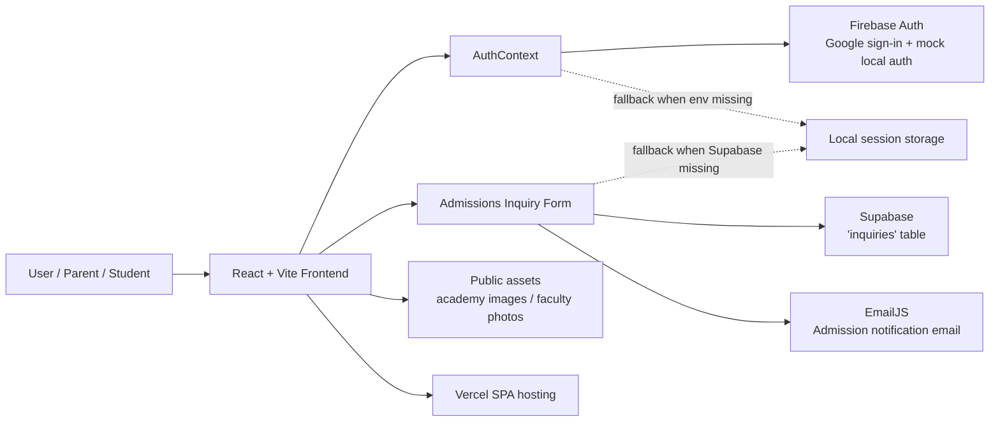

# 🚀 CamFord Academiya


CamFord Academiya is a polished single-page academy website for an elite O/A Level coaching institute in Lahore. It presents program details, faculty profiles, achievement sections, testimonials, admissions workflows, and contact capture in a fast React + Vite experience. Technically, the project stands out for combining a highly customized frontend with Firebase Authentication, Supabase persistence, and EmailJS notifications — all wired through environment-driven configuration with graceful local fallbacks.

> [!NOTE]
> This repository is a production-style marketing and admissions site. The codebase includes integrations for authentication, database persistence, and email delivery, but no separate backend service or dedicated AI agent runtime.

## ✨ Key Highlights

- **Single-page academy website** built with React 19, TypeScript, Vite, and Tailwind CSS 4.
- **Admissions inquiry flow** that stores submissions in Supabase when configured, with a local fallback when not.
- **Email notifications** powered by EmailJS for new admission inquiries.
- **Authentication support** via Firebase Auth with Google sign-in and role-aware mock login flows for local development.
- **Role-based UX** for student and admin views inside the same frontend application.
- **Rich visual presentation** with custom animations, scroll effects, card interactions, and responsive layouts.
- **Deployment-ready** for Vercel with SPA rewrite support.

## 🎯 Problem Statement

Educational institutions often need a website that does more than display static contact details. Prospective students and parents want clear program information, faculty credibility, achievements, and an easy admissions channel — all without navigating multiple pages or waiting for manual follow-up.

A simple brochure site is usually insufficient because it does not support:

- authenticated user flows,
- structured admissions data capture,
- email notifications for staff,
- flexible content organization for a large academy profile,
- or a polished mobile-first presentation.

## 💡 Solution

CamFord Academiya solves this with a carefully designed single-page experience that combines editorial content, admissions capture, and basic operational integrations in one place.

The app:

- presents the academy’s story and programs in a visually rich layout,
- captures admission inquiries through a frontend form,
- attempts to persist inquiries to Supabase,
- sends notification emails via EmailJS,
- and supports Firebase-backed sign-in when environment variables are present.

When integrations are not configured, the app degrades gracefully into local/mock behavior so the UI can still be exercised during development.

## 🧠 AI / GenAI Capabilities

The repository includes `@google/genai` in `package.json` and metadata marking a server-side Gemini capability, but no production AI workflow is implemented in the current source tree.

### Implemented today

- **No active RAG pipeline**
- **No agent orchestration layer**
- **No vector database integration**
- **No tool-calling loop in application code**
- **No prompt templates or generation endpoints found in `src/`**

### Planned / inferred from metadata

- The repository metadata indicates **`MAJOR_CAPABILITY_SERVER_SIDE_GEMINI_API`**.
- If AI features are added later, they should be documented here with exact implementation details.

## 🏗️ System Architecture



### Major components

- **React + Vite frontend**: the entire application runs client-side as a single-page app.
- **AuthContext**: centralizes login, logout, session persistence, and role assignment.
- **Firebase Auth**: used when Firebase environment variables are available.
- **Supabase**: used for storing inquiry records in the `inquiries` table when configured.
- **EmailJS**: used to notify the academy when a new inquiry is submitted.
- **Public assets**: extensive image library in `public/` supports the academy presentation.
- **Vercel config**: rewrites all routes to `index.html` so the SPA works on refresh.

## 🔄 How It Works

1. The app boots from `src/main.tsx`, which mounts `<App />` inside `<AuthProvider />`.
2. `src/firebase.ts` and `src/supabase.ts` read `import.meta.env` variables and create clients only when configured.
3. `AuthContext` loads any cached session from `localStorage` and syncs Firebase auth state when Firebase is enabled.
4. The main UI in `src/App.tsx` renders the academy experience and its admissions interaction points.
5. When a visitor submits an inquiry:
   - the form data is normalized,
   - the app tries to insert it into Supabase,
   - falls back to local state if persistence fails or is not configured,
   - sends an EmailJS message to the academy inbox,
   - and adds an in-app notification for the admin UI.
6. Authentication actions use Firebase Google sign-in when available; otherwise the app uses mock credentials for local testing.

## 🛠️ Tech Stack

| Category | Technology | Purpose |
|---|---|---|
| Frontend | React 19, Vite 6, TypeScript | Single-page application runtime |
| Styling | Tailwind CSS 4, custom CSS | Design system, responsive layout, animations |
| Authentication | Firebase Auth | Google sign-in and session management |
| Database | Supabase | Store admissions inquiries |
| Email | EmailJS | Send inquiry notifications |
| Motion / UX | GSAP, Lenis, Motion, Lucide React | Scrolling, animation, iconography, transitions |
| Deployment | Vercel | Static SPA hosting and rewrites |
| AI / GenAI | `@google/genai` (planned only) | Present in dependencies, not used in runtime code |

## 📁 Project Structure

```text
CamFord_Academiya/
├── public/                 # Academy images, banners, and profile photos
├── src/                    # React application source
│   ├── App.tsx             # Main single-page academy experience
│   ├── context/            # Authentication context and session state
│   ├── firebase.ts         # Firebase client initialization
│   ├── supabase.ts         # Supabase client initialization
│   ├── index.css           # Design tokens and global styles
│   ├── main.tsx            # Application entry point
│   └── *.tsx / *.css       # Reusable UI/animation components
├── Teachers Data/          # Reference documents and educator assets
├── index.html              # Vite HTML entry point
├── metadata.json           # AI Studio metadata
├── package.json            # Scripts and dependencies
├── tsconfig.json           # TypeScript configuration
├── vite.config.ts          # Vite build config and path alias
├── vercel.json             # Vercel deployment config
└── .env.example            # Required environment variables
```

**How it fits together:** this is a frontend-first application. `main.tsx` mounts the app, `AuthContext` manages identity, and `App.tsx` handles the academy content plus admissions workflow. Firebase, Supabase, and EmailJS are optional runtime integrations controlled entirely by environment variables.

## ⚙️ Configuration

Copy `.env.example` to `.env.local` and fill in the values you intend to use.

```bash
cp .env.example .env.local
```

### Environment variables

#### Firebase
- `VITE_FIREBASE_API_KEY`
- `VITE_FIREBASE_AUTH_DOMAIN`
- `VITE_FIREBASE_PROJECT_ID`
- `VITE_FIREBASE_STORAGE_BUCKET`
- `VITE_FIREBASE_MESSAGING_SENDER_ID`
- `VITE_FIREBASE_APP_ID`

#### Supabase
- `VITE_SUPABASE_URL`
- `VITE_SUPABASE_ANON_KEY`

#### EmailJS
- `VITE_EMAILJS_SERVICE_ID`
- `VITE_EMAILJS_TEMPLATE_ID`
- `VITE_EMAILJS_PUBLIC_KEY`

> [!IMPORTANT]
> Firebase Auth, Supabase persistence, and EmailJS notifications are optional. If the variables are missing, the app falls back to local/mock behavior instead of crashing.

## 🚀 Development

### Install dependencies

```bash
npm install
```

### Run locally

```bash
npm run dev
```

### Build for production

```bash
npm run build
```

### Preview the production build

```bash
npm run preview
```

### Type-check the codebase

```bash
npm run lint
```

## 🌐 Deployment

The repository includes a `vercel.json` file configured for a Vite SPA:

- build command: `npm run build`
- output directory: `dist`
- rewrite all routes to `/index.html`

This makes the app safe to deploy on Vercel without breaking client-side navigation on refresh.

## 📸 Assets and content

The `public/` directory contains a large set of academy images, faculty portraits, and banners used by the frontend. The `Teachers Data/` folder includes a `Teachers Profiles.docx` reference file and a `Pictures/` subfolder.

## ✅ Notes for maintainers

- The current `README.md` in the repository is a generated starter and does not describe the actual project; this document replaces that with repository-specific documentation.
- The package name is still the default `react-example`; consider renaming it if you want the published metadata to match the academy brand.
- There is no automated test suite checked into the repository at the moment.

## 📄 License

No license file is present in the repository snapshot provided here.
